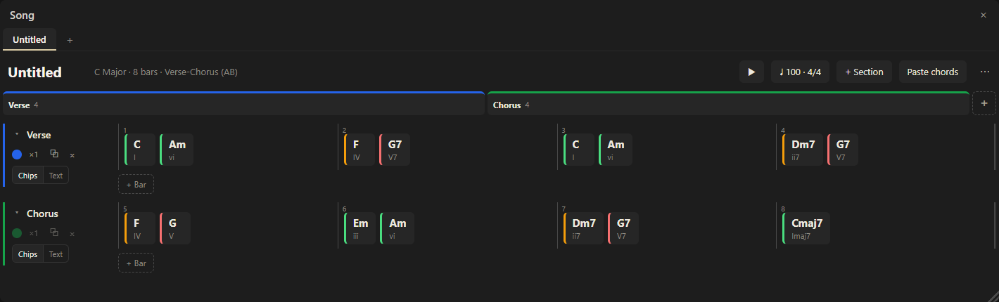

# Composing

Try progressions and write a song down.

## Try ideas

- Play chords and watch the numerals and functions; the **Next** panel suggests what can follow and why.
- **Progressions** gives named progressions in your key to start from.
- With **Hold**, a chord stays while you think. The circle of fifths and the Key panel show nearby and borrowed chords, negative harmony and substitutions.
- The **Metronome** gives a pulse: any meter including additive ones, talas, flamenco compás, claves, Euclidean rhythms and polyrhythms.

## The Song panel

Songs live in the browser, several at once, as tabs, each with its own key. A song is made of sections (Intro, Verse, Pre-Chorus, Chorus, Bridge, Outro) added with **+ Section**, with colours and repeat counts. The panel is not in the Standard layout: turn it on in the ▦ menu.

- **Chart:** measures flow four to a line, like a chord chart; each chord shows its numeral and borrowed chords are highlighted.
- **Form strip:** above the chart, the song as blocks as long as their bars. Click a block to go to its section; drag blocks to reorder.
- **Fill by playing:** arm a chord slot (⊙) and play; each chord fills a slot and arms the next, across measures and sections, until the end or `Esc`.
- **Write as text:** a section can be written as `Am F | C G`, `|` marking the bars; without bars each chord takes a measure. Paste a progression the same way.
- **Edit:** click a chord to select and play it. Rest the pointer on it (or focus it, or tap it on a touch screen) and four buttons appear above it: ✎ edits the symbol, ⧉ duplicates it, ⊙ arms it for MIDI fill and × removes it (`Del` does too, and the Undo toast brings it back). Drag chords and history chips between measures.
- **Transpose** the whole song by semitones from the ⋯ menu.
- **Play** with ▶, at the song's tempo and beats per bar, sections repeated as many times as set; the chart and the detector follow. ■ or `Esc` stops.
- **Export** as a printable chord chart from the ⋯ menu.

Deleting a chord, measure, section or song happens at once and shows an **Undo** toast.

## To a DAW

Pick an **Out** port in Settings and Modus sends what sounds to a synth or DAW through a virtual port such as loopMIDI. Previews, the computer keyboard and the on-screen piano are sent; the controller's own notes only with **Thru**.
