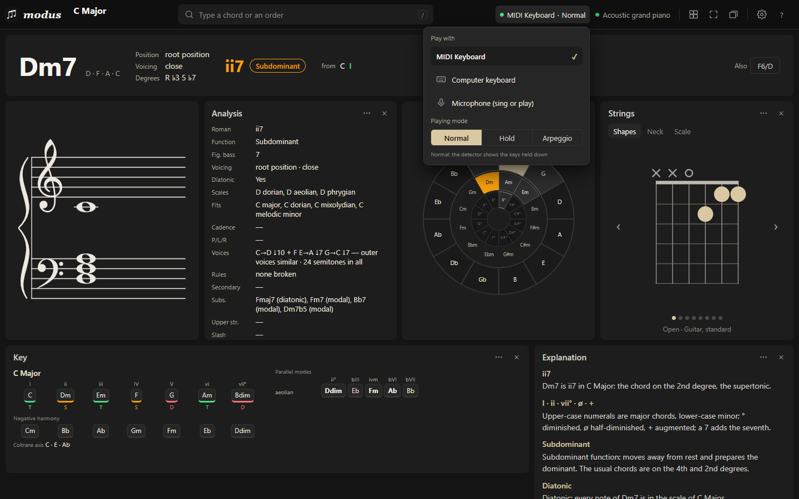
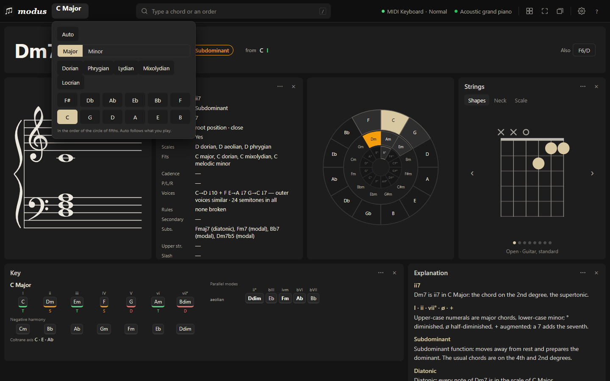
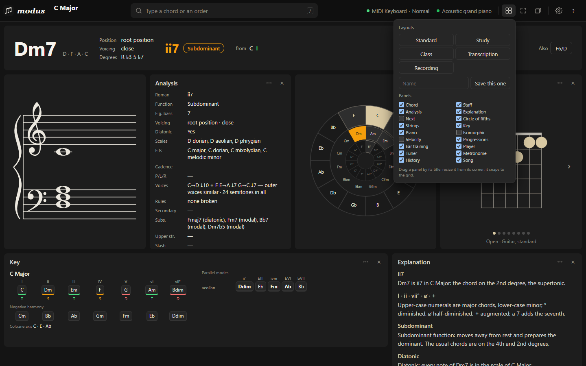
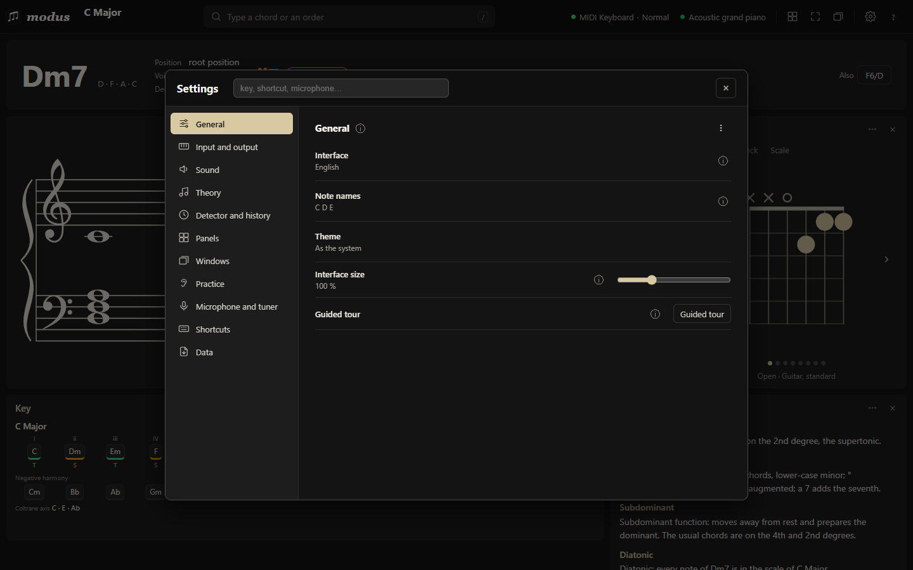

# Getting started

Open https://memoriainfinita.github.io/modus/ in Chrome, Edge or Firefox. The first visit starts a ten-step tour of the page; **?** › Guided tour starts it again.

## Play something

You do not need a controller.

The status at the top right of the bar (here "MIDI Keyboard · Normal") opens the **Play with** menu: your MIDI keyboard, the computer keyboard or the microphone, and below them the playing mode.

- **With a MIDI keyboard:** plug it in and pick it in that menu. The browser asks for MIDI permission the first time; Firefox asks once per site.
- **With the computer keyboard:** press `M`. A S D F… are the white keys, W E T… the black ones, Z / X change octave, C / V the velocity, Tab is the sustain pedal. `M` or `Esc` stops.
- **With the mouse or your fingers:** click the piano panel; on a phone it takes several fingers at once.
- **By typing:** press `/` and write a chord (`Dm7`, `G7b9`) or an order (a key, a layout, a panel).

Modus names what sounds as you play. One note gives its name and octave, two give the interval, three or more give the chord, with other readings next to it (keys `1`–`9` pick one).

## The key

The key at the top left of the bar sets the key you play in. Leave it on **Auto** and Modus finds it from what you play; every degree, function and cadence is read in it. Church modes work as keys too. On the circle of fifths, double-click a segment to make it the key.

## The page

Everything is a panel on a grid. Drag one by its title, resize it from its corner, hide it with ×. Its options are in its ⋯ menu. The ▦ button in the bar has ready-made layouts — Standard, Study, Class, Transcription, Recording — keeps layouts you save with a name, and has a box per panel to show or hide it. Panels snap to the grid and the others make room; nothing overlaps.

## Input modes

- **Normal:** the chord is what is held.
- **Hold:** the chord stays after you release, useful for arpeggios. `H` toggles it.
- **Arpeggio:** notes accumulate until 1.2 seconds pass with no new one. `A` toggles it.

## Install it, and offline

The browser offers to install Modus as an app. Once opened, it works offline: the piano plays offline from the first visit; another instrument plays offline once it has been played online. Your songs and settings stay in the browser.

## Settings

⚙ (or `,`) has a section for General (language, note names, theme, interface size, the guided tour), Input and output (MIDI device, channels and output), Sound, Theory (chord symbols such as Cmaj7 / CΔ7 / CM7, the key-detection profile, movable do), Detector and history (timings), Panels, Windows, Practice, Microphone and tuner, Shortcuts (two keys per action) and Data (export, import and reset of all settings to a file). The search at the top finds a setting by name.

