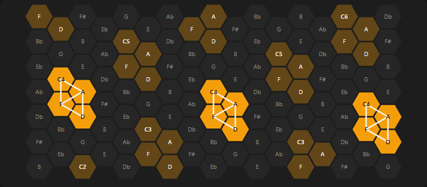
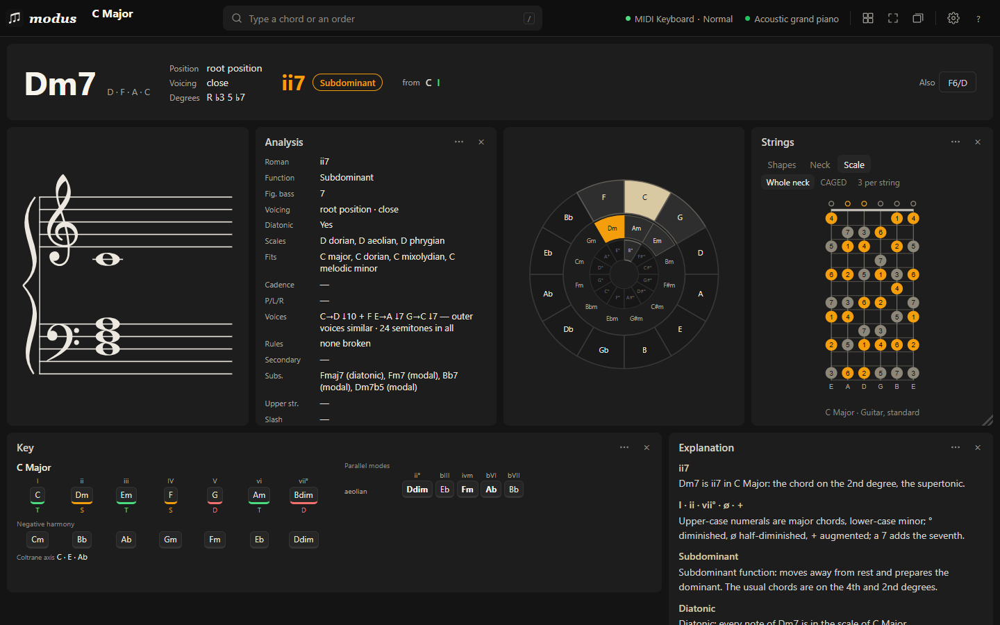
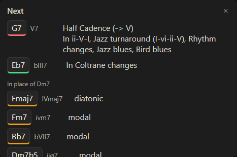
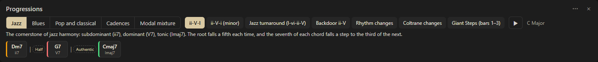

# Studying

Play a chord and ask Modus why it is what it is.

## Read a chord

With a key set, the **Chord** panel shows the name, its numeral (`ii7`, `V7/V`, `bVII`) and its function — Tonic, Subdominant or Dominant. **Analysis** adds the figured bass, the voicing (inversion, close or open, drop 2, doubled and missing notes), the scales that fit, substitutions and the cadence from the chord before. Its ⋯ menu picks which rows to show.

**Explanation** says each of those in words for the chord on screen: why D7 is V7/V, which mode a borrowed chord comes from and which notes are foreign to the key, what the cadence does. The cadence tags in the history explain themselves in their tooltip.

## Study a key

The **Key** panel shows the key without playing: its diatonic chords as triads or sevenths with their functions, the **negative harmony** of each, the **parallel modes** that use a note outside the key, and the **Coltrane axis**. Click a chord to hear it; the key does not change.

## See where it sits

- **Circle of fifths:** click a segment to play it.
- **Piano and Isomorphic keyboard:** the isomorphic grid keeps a chord's shape the same in every key, which makes patterns visible. It is not in any layout: turn it on in the ▦ menu.

- **Strings:** any fretted instrument, with playable chord shapes (**Shapes**), the whole neck (**Neck**), or a **Scale** view of the key's scale, over the whole neck, in CAGED shapes or three notes per string.

- **Staff:** the grand staff with the key signature. ⇠ draws the previous chord faded to see how each voice moves; its ⋯ menu writes note names or degrees beside it.

## Hear what comes next

**Next** lists chords that can follow the one on screen, each with every reason: where it resolves, the cadence it makes, the named progressions it continues, usual borrowings and substitutes. Click one to hear it. It is in the ▦ menu, not in the Standard layout.

**Progressions** has the classic ones — ii-V-I, blues, rhythm changes, Coltrane changes, the Andalusian cadence, plus cadences and modal mixture — in your key, bar by bar. Click a chord to hear it; ▶ plays the whole progression.

## Train the ear

**Ear training** plays an interval, a chord quality, a cadence or scale degrees without showing it; you name it, it keeps a score and shows the answer on the staff, the piano and the analysis. The scale-degree tab answers in movable do.

The **Study** layout (▦ menu) puts these panels together.
