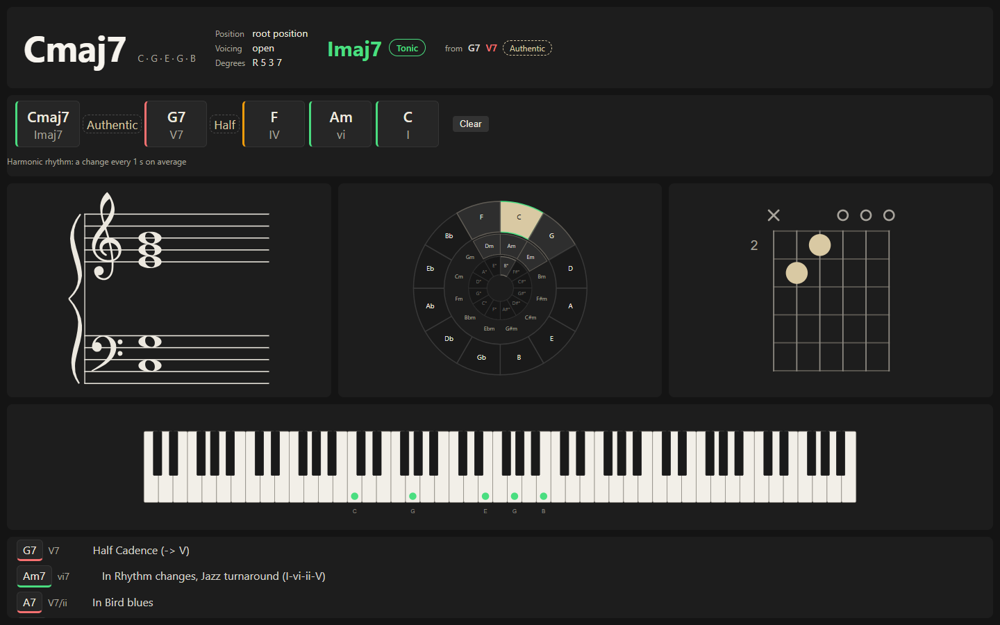

# Teaching

Modus is made to be projected: explain harmony with something that reacts to what you play.

## Set up the room

1. Pick the **Class** layout (▦ menu). It puts the chord large, with the history under it, and is made for a projector.
2. Press `P` (or ⛶) for **presentation**: the layout fills the screen without controls; `Esc` leaves. At small projector sizes a layout that does not fit keeps its own sizes and scrolls instead of squeezing.

3. Choose the theme in Settings: dark, light, high contrast or paper.

## During the lesson

- Play a progression and let the history show the numerals, the cadences between chords and the modulations.
- Use **Explanation** to put the term in words, and **Progressions** — with its cadence and modal-mixture examples — to show a thing before naming it.
- Switch between letters and Do Re Mi (fixed or movable do) in Settings, and the interface between English and Spanish.
- The circle of fifths, the Key panel, the staff and the isomorphic grid show the same chord from different sides.
- Students can use it on their own devices: it is a web page, works on a phone, and on a computer without a controller.

## Exercises

**Ear training** plays intervals, chord qualities, cadences or scale degrees and scores the answers. The **Player** loops a passage of a recording for a transcription exercise. The **Metronome** and **Tuner** are on hand.

Everything works from the keyboard and with a screen reader, which hears each chord with its degree and function.
